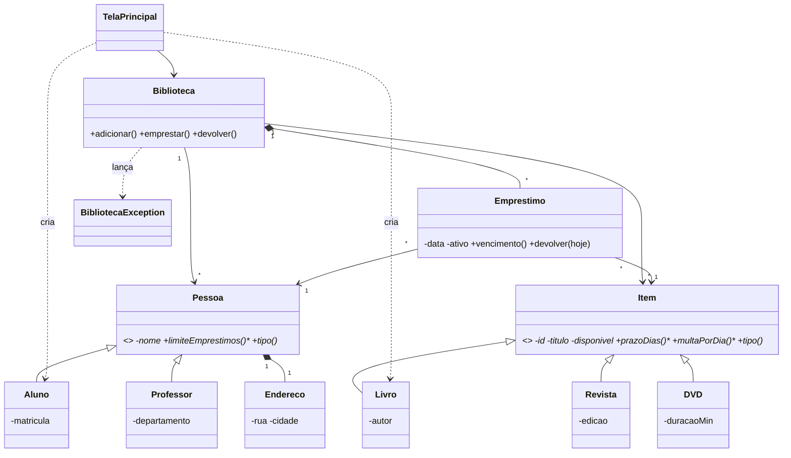

# Projeto Desktop — Biblioteca Universitária (Desk App I)

Aplicação desktop em **Java (Swing)**, sem dependências externas, para a disciplina de **Orientação a Objetos** (UnB).
Cadastra itens (Livro, Revista, DVD) e pessoas (Aluno, Professor), registra empréstimos e devoluções com cálculo de multa.

## Relações de OO presentes

| Relação | Onde |
|---|---|
| **Herança** | `Item` ← `Livro`, `Revista`, `DVD` · `Pessoa` ← `Aluno`, `Professor` |
| **Polimorfismo** | `prazoDias()`, `multaPorDia()`, `limiteEmprestimos()`, `toString()` sobrescritos em cada subclasse |
| **Composição** | `Pessoa` ◆ `Endereco` (criado dentro da pessoa) · `Biblioteca` ◆ `Emprestimo` (criado por `emprestar`) |
| **Associação** | `Emprestimo` → `Pessoa`/`Item` · `Biblioteca` → `Item`/`Pessoa` · `TelaPrincipal` → `Biblioteca` |
| **Dependência** | `Biblioteca` ⇢ `BibliotecaException` · `Emprestimo` ⇢ `LocalDate` · `TelaPrincipal` ⇢ `Livro`/`Aluno`/... |

## Diagrama UML



Versão PlantUML: [`docs/diagrama.puml`](docs/diagrama.puml) (renderize em https://www.plantuml.com/plantuml).

## Como executar (JDK 11+)

**Linux / macOS**
```bash
mkdir -p out && javac -encoding UTF-8 -d out $(find src -name "*.java")
java -cp out Main
```
**Windows (cmd)**
```bat
dir /s /b src\*.java > fontes.txt
javac -encoding UTF-8 -d out @fontes.txt
java -cp out Main
```

## Testes automáticos
```bash
javac -encoding UTF-8 -d out $(find src test -name "*.java")
java -cp out TestesRunner
```

## Regras de negócio
| Item | Prazo | Multa/dia | | Pessoa | Limite |
|---|---|---|---|---|---|
| Livro | 14 dias | R$ 1,00 | | Aluno | 3 |
| Revista | 7 dias | R$ 0,50 | | Professor | 5 |
| DVD | 3 dias | R$ 2,00 | | | |

Roteiro do vídeo: [`docs/ROTEIRO_VIDEO.md`](docs/ROTEIRO_VIDEO.md)
